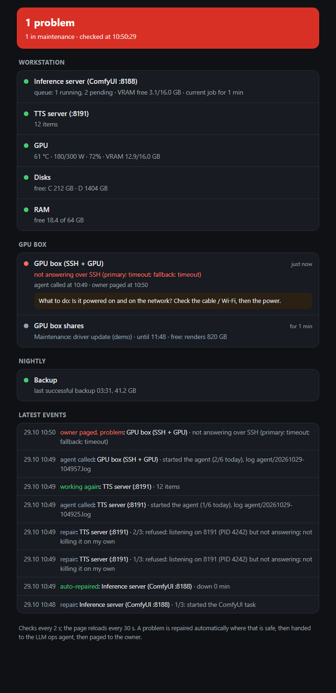
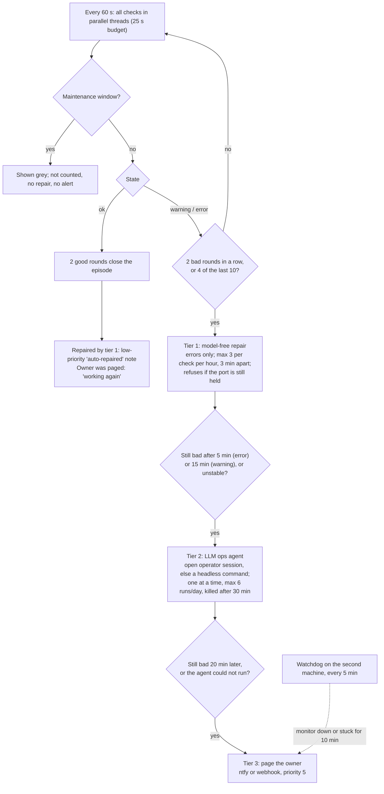

# gpu-ops-monitor

A self-healing monitor for a small fleet of GPU inference servers (ComfyUI, a TTS server, the GPUs, disks, RAM,
driver resets, backups and scheduled jobs). Every minute it runs all its checks; a problem first gets a
**model-free repair**, then an **LLM ops agent**, and only then **pages the owner**. A watchdog on a second
machine pages the owner if the main machine, and with it the monitor, goes down.

It is a single stdlib-only Python file plus a PowerShell watchdog, built for and run on two Windows GPU machines.
This repository is the public, config-driven version of that monitor, with a demo mode that needs no GPU.



## How it works



All alerts of one round go out as one message (a dead machine is one notification, not four). State survives a
restart, so a restart neither repeats a page nor forgets one.

## Quickstart: the demo (no GPU, no config)

Requires Python 3.11+ and nothing else.

```
git clone <this repo> gpu-ops-monitor
cd gpu-ops-monitor
python monitor.py demo          # open http://127.0.0.1:8198 while it runs
```

The demo runs the real engine (tracker, repairs, agent tier, notifications, dashboard) against simulated probes,
with every threshold divided by 30, so one round is 2 s and the whole story takes about two minutes. The agent is
`demo_agent.py`, a stand-in started exactly like a real agent command. Notifications are printed instead of sent.
Real output from one run (some event lines omitted, the temp path shortened):

```
demo: dashboard http://127.0.0.1:8198/ · data <temp>\gpu-ops-demo-0oprpiqm · one round = 2 s, 64 rounds
[r05    10s] simulating: the inference server crashes
[r06    12s] event repair: Inference server (ComfyUI :8188) · 1/3: started the ComfyUI task
[r08    16s] NOTIFY p2: Auto-repaired: Inference server (ComfyUI :8188) (down 0 min)
[r14    28s] simulating: the TTS server hangs (process alive, port held, no answers)
[r15    30s] event repair: TTS server (:8191) · 1/3: refused: listening on 8191 (PID 4242) but not answering: not killing it on my own
[r19    38s] event agent: TTS server (:8191) · started the agent (1/6 today), log agent/20261029-105339.log
[r22    44s] event resolved: TTS server (:8191) · 12 items
[r30    60s] simulating: the GPU box drops off the network
[r35    70s] event agent: GPU box (SSH + GPU) · started the agent (2/6 today), log agent/20261029-105411.log
[r51   102s] NOTIFY p5: Problem: GPU box (SSH + GPU)
              | not answering over SSH (primary: timeout; fallback: timeout)
              | What to do: Is it powered on and on the network? Check the cable / Wi-Fi, then the power.
              | Agent called at 10:54, not resolved.
[r60   120s] simulating: the GPU box is back
[r61   122s] NOTIFY p2: Working again: GPU box (SSH + GPU)
              | 52 °C · 31/115 W · 4% · VRAM 1.2/16.0 GB · via primary
```

Three scenarios, one per tier: a crash that a restart fixes (tier 1, nobody woken), a hung process that the
repair refuses to kill and the agent fixes (tier 2), and a machine off the network that only a human can fix
(tier 3, then "working again" when it returns). `python monitor.py demo --no-wait` exits at the end instead of
keeping the page up.

## Using it for real

```
copy config.example.toml config.toml        # then edit hosts, checks, notifications
set MONITOR_NTFY_TOPIC=<your private topic>  # or topic_file in the config
python monitor.py once                       # one round, printed; no repairs, no notifications
python monitor.py run                        # the permanent process (dashboard on dashboard_host:dashboard_port)
python monitor.py install                    # Windows: a logon task that runs `run` with pythonw
python monitor.py maintenance gpu-box 30 driver update   # mute a check or a group; `... gpu-box done` ends it
python monitor.py test-escalation            # test the hand-off to an open operator session
```

### Configuration

Everything lives in `config.toml` ([config.example.toml](config.example.toml) documents every key). Credentials never
go in the file: the notification topic comes from `MONITOR_NTFY_TOPIC` (or a file only admins can read) and is
masked in every error message; `MONITOR_NOTIFY_URL` and `MONITOR_DIR` override the URL and the data directory.

| Section | What it sets |
|---|---|
| `[monitor]` | interval, data directory, dashboard bind address/port, the dashboard link used in messages |
| `[notify]` | `ntfy` (topic in the JSON body), `webhook` (same JSON to any URL) or `console` |
| `[escalation]` | rounds to alert, the unstable window, repair caps, the agent and owner delays |
| `[agent]` | the agent command (`{prompt}` placeholder), caps, inherited variables to drop, optional operator-session hand-off |
| `[maintenance]` | named groups of checks, an optional flag file written by a remote host's own maintenance script |
| `[hosts.<name>]` | SSH targets: primary address, optional fallback route (e.g. a VPN address, same host key), user |
| `[[checks]]` | one entry per check: `id`, `group`, `name`, `type`, its parameters, `fix` text, optional `[checks.repair]` |

Check types:

| `type` | Detects | Notes |
|---|---|---|
| `comfyui` | down; stuck job (90 min); dead queue thread (a job "runs" on an idle GPU for 5 min); 2+ jobs in a row failing with GPU errors | optional `fallback_url`; `idle_gpu_node` = a node that frees the GPU on purpose |
| `http` | any JSON endpoint not answering | |
| `scheduled_task` | a Windows task that should be running is not | Windows |
| `gpu` | temperature, lowered power limit (blocked airflow on laptops), via `nvidia-smi` locally or over SSH | remote reads twice: the first read after idle can be bogus |
| `disks` | free space under warn/error thresholds, local or network shares | |
| `ram` | low free RAM for N rounds in a row; optional `heavy_job` that may fill RAM while it works but not while stuck | Windows |
| `driver_resets` | video driver resets (TDR: nvlddmkm 153, Display 4101) in the last hour | Windows |
| `host_state` | the remote host's state written by the watchdog: on battery, watchdog stale, monitor unreachable, driver errors, pending reboot | over SSH |
| `scheduled_jobs` | a nightly task missed its run, failed, or ran without writing its state file | Windows |
| `git_push_state`, `backup_state` | the state files of a push job and a backup job: stale, rejected branches, partial errors | local or over SSH |

Any check can take `every_s` to run at most that often (expensive checks). Repairs are a command that starts the
service and returns (a scheduled task, a service manager), run locally or over SSH, with `refuse_if_listening`
(something still holds the port: do not start a second copy, leave the hung one to the agent or the owner) or
`refuse_if_ok` (re-check right before acting).

### The watchdog

[watchdog/](watchdog/) is a PowerShell script for the second machine, run every 5 minutes by a scheduled task that
needs nobody logged on. It writes the machine's own state (power, battery, driver errors and resets since the
driver install, pending reboot, Windows Update policy) for the `host_state` check, and it polls the main monitor's
`/api/status`. If the monitor stays unreachable for 10 minutes, or is stuck (no completed round for 10 minutes)
for another 10, it pages the owner directly, telling apart "main host offline" from "host up, monitor dead" with a
ping, and repeats after 1, 2, 4... hours.
Install: copy `watchdog.example.json` to `watchdog.json`, put the topic in
`C:\ProgramData\gpu-ops-watchdog\ntfy_topic.txt`, run `install_watchdog.ps1` as Administrator. The dashboard must be
reachable from that machine: bind `dashboard_host` to a private interface (LAN or
VPN).

`comfy_queue.py` is the companion tool for the dead-queue case: it saves a ComfyUI queue, and after a restart puts
it back with the same prompt ids, so clients waiting on their results reattach without duplicates.

## Tests and CI

```
uvx pytest            # or: python -m pip install pytest && python -m pytest
```

99 test cases (86 test functions), offline: fake HTTP servers, fake SSH and command runners, a fake clock, and the
demo scenario end to end on a fake clock with the real `demo_agent.py` subprocess. Three tests call real Windows
APIs (the `wevtutil` query, `GlobalMemoryStatusEx`, the PowerShell task query) and are skipped elsewhere.
[.github/workflows/ci.yml](.github/workflows/ci.yml) runs the suite on Ubuntu with Python 3.11 and on Windows with
Python 3.13.

## Design decisions

- **Model-free repair first.** The most common failure is a service process that died. Restarting it is
  deterministic, takes seconds and costs nothing, so it runs at the second bad round, before anything smarter. It
  only acts on errors, never on warnings, and it refuses when something still holds the port: a hung process may be
  mid-job or holding GPU memory, and killing it is a judgment call.
- **Caps everywhere.** Repairs: at most 3 per check per hour, 3 minutes apart, so a crash loop cannot become a
  restart loop. Agent: one run at a time, at most 6 runs a day, killed after 30 minutes. The worst case for cost
  and blast radius is known in advance.
- **The agent gets data, not instructions.** Text in the escalation comes from other machines and from files other
  programs write. It is reduced to one line without brackets, backticks, `$` or pipes, length-capped, and
  introduced as data. The watchdog's free text is mapped to fixed categories; GPU exception messages (chosen by
  whoever submits a job) never leave the check.
- **Prefer an open session.** If an operator session is open (it touches a heartbeat file), the escalation goes to
  its inbox: it already has context. Otherwise a headless agent command starts. If neither can run, the owner is
  paged at once, with the reason.
- **Wake the owner last, and only once.** 20 minutes after the agent, priority 5. "Auto-repaired" and "working
  again" go at priority 2. One message per round, one page per episode; a warning that becomes an error pages
  again, and a new cause inside an alerted episode (a check can return the keys of what broke) opens a new episode
  instead of being swallowed.
- **Hysteresis.** Two bad rounds before acting, two good rounds before "resolved"; 4 bad rounds out of 10 marks a
  check unstable and escalates it at once; warnings wait 15 minutes before the agent.
- **Maintenance windows** for a check or a group, from the CLI, from the agent (its prompt says to open one before
  stopping anything on purpose), or from a flag file the remote host's own maintenance script writes.
- **A watchdog on a second machine.** The monitor and the agent live on the main machine. If it loses power or
  hangs, nothing on it can page anyone. The watchdog checks freshness, not just reachability, so it also catches a
  monitor that answers HTTP but has stopped checking. The two machines watch each other: the monitor reads the
  watchdog's state, the watchdog reads the monitor's.
- **Stdlib only, one file.** Deployment is a file copy, and nothing breaks when the GPU stack on the same machine
  upgrades its Python packages.

## The outage behind the tiers

The first version of this monitor was a dashboard plus a phone notification. One night the inference server on
the second GPU machine went down and stayed down for about five hours; the jobs waiting for it did not run until
morning. An alert at night waits for a person to wake up. The tiers were added right after: restart what can be
restarted safely, hand the rest to an agent that can diagnose, and wake the owner only when both have failed. The
watchdog came with them, because the same reasoning applies to the monitor itself.

## Limitations

- **A generic subset.** The author's own deployment runs 18 checks; `config.example.toml` ships the 15 that make sense outside that setup.
- **Windows first.** Scheduled tasks, the RAM and driver-reset checks, the `netstat` parsing and the example
  repairs are Windows-specific. The HTTP, ComfyUI, GPU, disk, SSH and state-file checks are portable, and the test
  suite runs on Linux.
- **One owner, one instance.** No on-call rotation, acknowledgements or high availability beyond the watchdog.
- **The agent is as safe as its command.** The monitor caps how often and how long it runs, not what it may do;
  give the agent command only the permissions you want it to have.
- **No authentication on the dashboard.** It binds to localhost by default; publish it only on a private network.
- **New check types need code**: a function returning `(state, detail)` and one branch in `build_check`.
- **This is a generalized copy.** The engine, the checks and their tests come from the private deployment; the
  config loader, the webhook/console notifiers, the operator-session hand-off via a heartbeat file, the watchdog's
  ping-based host check and the demo are new in this version and have been exercised by the tests and the demo
  only, not in production. The watchdog scripts have not been run in this form.

## How this was built

Built with AI coding agents (Claude Code), which wrote most of the code. I owned the architecture (the three
tiers, the caps, the hand-off to an open session, the watchdog on a second machine), the review gates and the
verification. What was verified, and how:

- The test suite (99 cases) passes on Windows with Python 3.13 and on Linux with Python 3.11, three Windows-only
  tests skipped on Linux.
- The tests can fail: four deliberate bugs (repair cap off by one, owner paged a minute late, GPU-error threshold
  raised, the fallback-route warning removed) each broke the suite.
- Regression tests encode incidents from the private deployment: a dead ComfyUI queue thread that left a job
  "running" on an idle GPU for almost two hours, a bogus first GPU power reading after idle (588 W at 0%), a second
  missed job hidden inside an episode already alerted. A review finding (text read from other machines could carry
  instructions into the agent's prompt) has its own tests.
- The checks that touch Windows (`wevtutil` query, `GlobalMemoryStatusEx`, the scheduled-task PowerShell) are tested
  against the real APIs, not only against fakes.
- The demo was run end to end (output above) and the dashboard screenshot was rendered from it.
- Before publishing, the code and its git history were searched for private names, hosts, paths and credentials.

## License

MIT, see [LICENSE](LICENSE).
